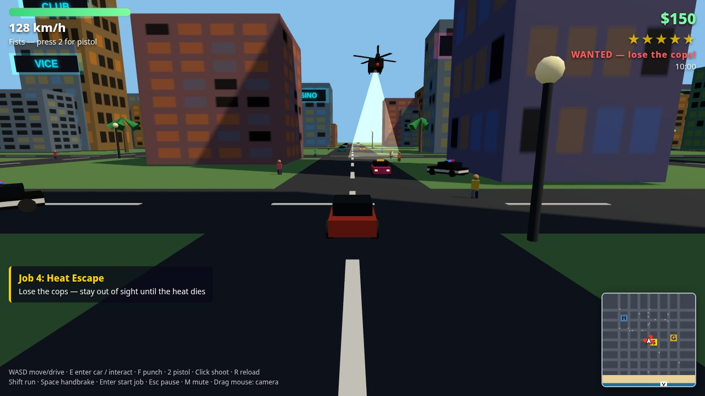
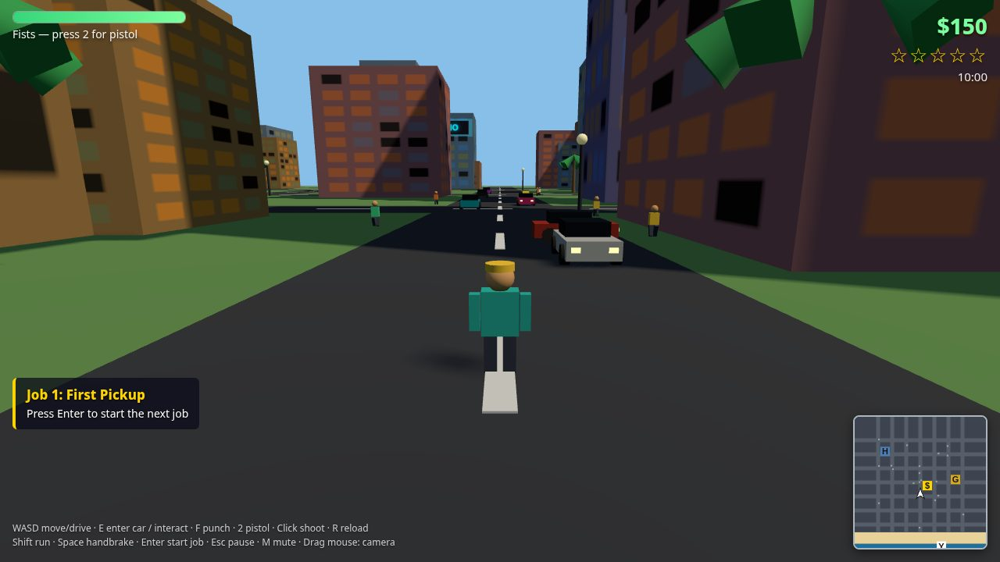
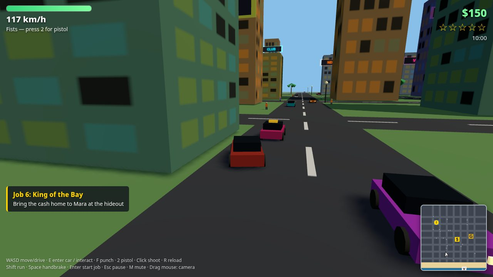
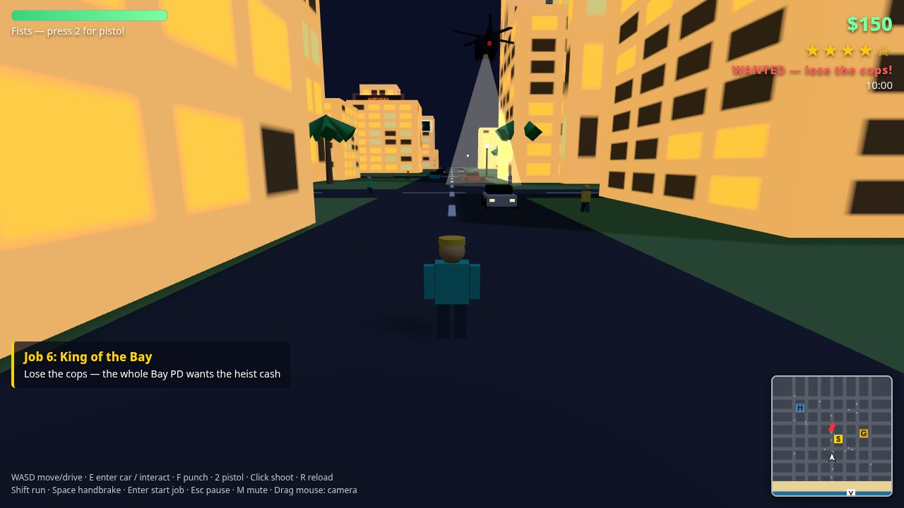

# Neon Bay — Open World

[](https://make.fun/bounty/gta6-01?utm_source=github&utm_medium=readme&utm_campaign=gta6-01)
[](https://make.fun/bounty/gta6-01/leaderboard?utm_source=github&utm_medium=readme&utm_campaign=gta6-01)
[](https://make.fun/bounty/gta6-01?utm_source=github&utm_medium=readme&utm_campaign=gta6-01)

**Neon Bay** is a complete open-world crime game for the make.fun "Make GTA 6"
bounty: explore a sun-soaked coastal city on foot and by car, steal cars,
outrun the Bay PD (including a police helicopter at 4+ stars), fight, and run
six story missions as Kai Reyes — from a marina pickup to the Coral Bank
heist, a yacht escape, and a final run to bring the heist cash home. Shot in
HD: four cinematic 1280×720 renders, with a neon-drenched night downtown.






## Play it

Serve the game locally — no build step, no network:

```sh
node serve.ts
# then open http://localhost:8080
```

`game/index.html` is the whole game: Three.js r160 is vendored under
`game/vendor/`, so it plays fully offline. Progress saves on this computer
(localStorage); **New Game** starts Kai over from job one.

## The story — six jobs

Kai Reyes came back to the Bay with nothing but a busted scooter and a
debt. Six jobs stand between him and the whole city:

1. **First Light** — pick up the package at the marina and deliver it to
   the hideout. The Bay is quiet. For now.
2. **The Comet GT** — steal the yellow Comet GT parked downtown and bring
   it to the garage. Stealing a stranger's car earns heat.
3. **Tail the Courier** — shadow the white courier van across the city
   without being spotted, then grab the briefcase it drops.
4. **Heat Escape** — the setup starts at three stars. Break the line of
   sight, hold it for five seconds, and vanish.
5. **The Coral Bank Job** — crack the vault downtown (hold E for five
   seconds under the cameras), then run the cash to the yacht.
6. **King of the Bay** — four stars from the first second. Escape the heat,
   carry the heist cash home to the hideout, and hold E for six seconds to
   bank it. $10,000. The Bay is yours.

Press **Enter** to start the next job. A yellow beacon and the HUD arrow
always point at the current objective, and the minimap shows the city, the
police, traffic, and the target.

## The city

Neon Bay is a fully original, procedural coastal city: a downtown grid of
ten towers with lit windows and neon signs, a marina with a yacht and
crates, a beach and boardwalk with palms, a park, and a garage and hideout
on the west side. Twenty traffic cars drive the grid and stop at lights;
thirty-eight pedestrians walk the sidewalks and scatter when you steal a
car or open fire. The day has a sun cycle — and at night the city flips:
lit windows, neon signs and streetlights glow against dark streets, and
the bay reflects the skyline.

## Systems

- **Driving** — WASD to drive, Space for the handbrake, E to enter or
  leave a car. Any car on the street can be stolen — at a cost.
- **Wanted** — 0 to 5 stars. Stealing, hitting a pedestrian, shooting, or
  being seen on a job raises heat. Police cars chase and ram; at 4+ stars
  a helicopter circles and drops cruisers. Lose the line of sight to cool
  down; at 5 stars the hunt never stops.
- **Combat** — F to punch, 2 for the pistol, click to shoot, R to reload.
  Police return fire, and getting busted or beaten sends Kai back to the
  hideout (minus the job).
- **HUD** — health, cash, wanted stars, speed, clock, mission panel,
  objective arrow, and a live 2D minimap.
- **Sound** — a fully synthesized WebAudio score: engine hum, police
  sirens, gunshots, pickups, and a night-drive music loop. M mutes.
- **Save** — cash, respect, and mission progress persist in localStorage.

## Screenshots

The four screenshots are real renders of the game, captured headlessly at
1280×720 with a fixed seed (`?shot=…&seed=1337`, see `shots.json`):

| Shot | Scene |
| --- | --- |
| `1-cover.jpg` | Five-star chase — a police convoy, traffic, and pedestrians downtown |
| `2-city.jpg` | Morning on the boardwalk, facing north to downtown |
| `3-mission.jpg` | Mission six: the finale staged at the hideout |
| `4-night.jpg` | Night neon — four stars, two cruisers, glowing signs and windows |

## Layout

One job per file — every system lives in its own module under `game/src/`:

| File | Job |
| --- | --- |
| `game/index.html` | Canvas, HUD, minimap, title / pause / game-over screens |
| `game/src/main.js` | Boot, game loop, camera, player, enter/exit car, game over |
| `game/src/config.js` | World constants, colours, player/car/wanted tuning, missions |
| `game/src/city.js` | Buildings, roads, streetlights, neon signs, beach, landmarks |
| `game/src/vehicles.js` | Car meshes, player driving, traffic AI, collisions |
| `game/src/pedestrians.js` | Pedestrian meshes, walking, scattering, knockdowns |
| `game/src/police.js` | Wanted level, pursuit, roadblocks, helicopter |
| `game/src/combat.js` | Punching, shooting, reload, police return fire |
| `game/src/missions.js` | The six-job chain: steps, triggers, rewards |
| `game/src/hud.js` | HUD text, minimap, banners, toasts, flashes |
| `game/src/input.js` | Keyboard, mouse drag camera, touch controls |
| `game/src/audio.js` | WebAudio synth: engine, sirens, shots, music |
| `game/src/shots.js` | Deterministic `?shot=` staging for the screenshots |
| `game/vendor/three.module.min.js` | Three.js r160, vendored |
| `main.ts` / `serve.ts` | Dossier builder / local static server |
| `shots.json` | The four screenshot definitions |

## Credits

Neon Bay is an original game built for the make.fun "Make GTA 6" bounty.
The city, the characters, the missions, and the story are all invented —
no assets, names, or locations were taken from any existing game.
Three.js is vendored under the MIT license.
